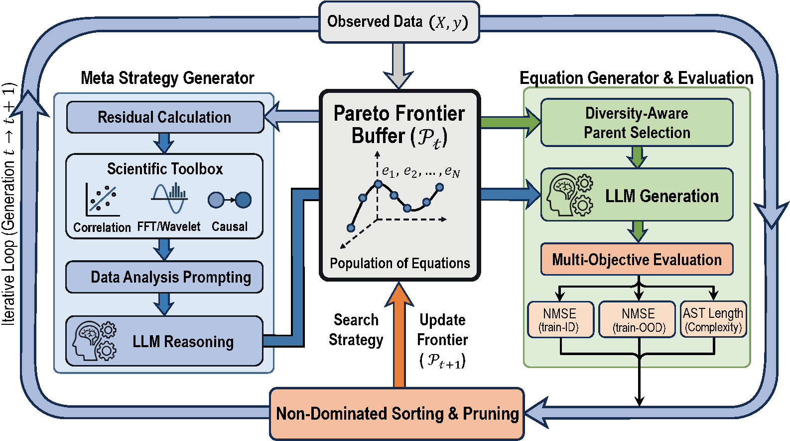

# MOT-SR

Code and reproducibility materials for the paper **“MOT-SR: Multi-Objective Tool-Augmented Symbolic Regression via LLMs”**.



## News

- **2026-11-13** — MOT-SR is accepted to **KDD 2027** as an **Oral** presentation 🎉
- **2026-07-31** — Preprint released on [arXiv:2607.29561](https://arxiv.org/abs/2607.29561)

## Minimal Usage

- Environment: see [requirements.txt](./requirements.txt) or [environment.yml](./environment.yml)
- Main entry: [main.py](./main.py)
- Example script: [run_motsr.sh](./run_motsr.sh)

## Reproducibility

See the [English](REPRODUCIBILITY.md) and
[中文](REPRODUCIBILITY.zh-CN.md) reproducibility guides for the environment,
prompts, experiment settings, random seeds, API usage and runtime logs.

## Final equations

The four benchmark equation structures from MOT-SR (LLaMA-3.1) and the
fitted EMRI correction are available in
[results/final_equations](results/final_equations/README.md).

## EMRI case generation

EMRI case generation code: [FSI](scripts/emri/generate_fsi_case.py) and [PN5](scripts/emri/generate_pn5_case.py).

## Citation

```bibtex
@misc{wang2026motsrmultiobjectivetoolaugmentedscientific,
      title={MOT-SR: Multi-Objective Tool-Augmented Scientific Equation Discovery with Large Language Models}, 
      author={Boxiao Wang and Runxiang Wang and Kai Li and Chongming Li and Zhiwei Chen and Yifan Zhang and Jian Cheng},
      year={2026},
      eprint={2607.29561},
      archivePrefix={arXiv},
      primaryClass={cs.LG},
      url={https://arxiv.org/abs/2607.29561}, 
}
```
